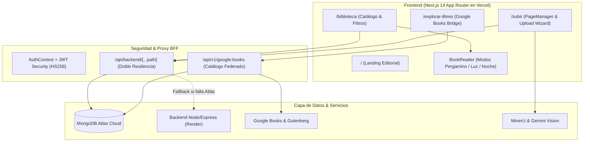

# Bitácora de Cambios Relevantes y Arquitectura · Babilon

**Proyecto:** Babilon — Plataforma Editorial & Archivo Eclesiástico en la Nube  
**Equipo:** Zenit · **Integrantes:** Lopez Hu Jose Yael, Zapata Paredes Luiz Yael, Manzanilla Bass Emmanuel  
**Fecha de actualización:** 19 de noviembre de 2026  
**Último commit analizado:** `9cb16d9` (*feat(google-books): ampliar respaldos de descarga de texto y portadas de obras libres*)

---

## 1. Resumen Ejecutivo del Último Cambio (`9cb16d9`)

El cambio más reciente integró un **motor híbrido federado** entre el catálogo curado de Babilon, **Gutendex (Project Gutenberg API)** y **Google Books API**. 

### ¿Qué se resolvió exactamente?
1. **Multiplicación del Catálogo de Dominio Público:**
   - Anteriormente, el explorador `/explorar-libres` solo ofrecía una lista estática de 39 obras curadas. Si el usuario buscaba un libro o superaba esa cantidad, la lista se agotaba.
   - Con este cambio, la API realiza una **paginación dinámica y cálculo de ventana bajo demanda** contra Gutendex (`https://gutendex.com/books?languages=es`), permitiendo navegar y consultar **cientos de obras completas en español**.
2. **Resiliencia de Descarga de Textos Completos:**
   - Cada obra ahora transporta enlaces de respaldo directos (`fullTextUrl` y `coverUrl`) hacia servidores certificados de Project Gutenberg (`PGLAF` y `XMission`), evitando enlaces rotos.
3. **Caché en Memoria de Gutendex (TTL 10 minutos):**
   - Se implementó `gutendexPageCache` para memorizar respuestas de páginas externas durante 10 minutos, protegiendo al backend de cuellos de botella y de bloqueos por límite de peticiones (Rate Limiting).
4. **Verificación Automática de Existencia en MongoDB:**
   - Cuando se consulta la lista externa, el endpoint revisa en tiempo real (con caché de 20 segundos) qué libros ya fueron importados en la base de datos de MongoDB Atlas (`existingCodes` y `existingTitles`), marcándolos como `alreadyInDb: true` para evitar duplicados accidentales.
5. **Importación con Paginado Automático y Persistencia:**
   - La función `POST /api/v1/google-books` permite al Administrador descargar la obra completa de forma asíncrona, procesar el texto plano con el algoritmo editorial de paginación (`paginateFullBookToTargetPages`) y guardarlo con todas sus hojas en MongoDB Atlas.

---

## 2. Mapa de Cambios Relevantes en la Aplicación (Evolución Reciente)

A continuación se sintetizan los módulos y capacidades más importantes implementadas en Babilon:

---

## 3. Desglose de Funcionalidades Principales

### A. Módulo `/explorar-libres` (Federación Google Books & Gutenberg)
* **Archivo principal:** `apps/web/src/app/api/v1/google-books/route.ts` y `GoogleBooksExplorerView.tsx`.
* **Rol:** Exclusivo para administradores.
* **Capacidades:**
  - Búsqueda en vivo por palabra clave o por categorías temáticas (*Literatura*, *Filosofía*, *Historia*, *Poesía y Teatro*, *Ciencia y Ensayo*).
  - Paginación continua por lotes (`startIndex` y `maxResults`).
  - Previsualización del libro en modal con sinopsis, año, autor e ISBN.
  - Botón **"Importar a la Biblioteca"** con retroalimentación animada (SweetAlert2) que descarga el texto, calcula páginas legibles y lo almacena en MongoDB.

### B. Módulo `/biblioteca` (Catálogo, Filtros y Paginación)
* **Archivos clave:** `BibliotecaView.tsx`, `useBooksCatalog.ts`, `CatalogFilterDropdown.tsx`, `BookCard.tsx`.
* **Capacidades:**
  - **Filtros combinados con debounce (280ms):** Búsqueda textual por título/autor/palabras clave combinada con filtros facetados de géneros y autores.
  - **Paginación robusta por bloques (Limit 20):** Implementa cursor opaco codificado en Base64 para evitar el error de desbordamiento de memoria de MongoDB Atlas (`Sort exceeded memory limit of 32MB`).
  - **Diseño de Interfaz Editorial:** Tarjetas con elevación suiza, fondos en tonos crema cálido (`#FBF8F3`) que eliminan el deslumbramiento del blanco puro.

### C. Lector Digital Inmersivo (`BookReader.tsx`)
* **Capacidades:**
  - 3 modos de color ergonómicos: **Pergamino** (cálido editorial), **Claro** (nítido balanceado) y **Noche** (grafito profundo).
  - Paginación continua o carrusel hoja a hoja con contador de páginas.
  - Control de tipografía (*Newsreader*) con escalado de tamaño (14px - 26px).
  - Modo pantalla completa y persistencia del progreso de lectura (`useReadingProgress`).
  - Carga bajo demanda de páginas (`GET /api/libros/:id/paginas`) que descarga solo bloques de 10-20 páginas, optimizando el uso de datos en móviles.

### D. Digitalización, Ingesta y OCR (`PageManager.tsx` & `UploadView.tsx`)
* **Capacidades:**
  - Soporte de subida y arrastre de archivos (*Drag & Drop*) para PDFs, Markdown y texto plano.
  - **PageManager interactivo:** Permite al administrador revisar hoja por hoja, corregir texto, buscar palabras o excluir páginas preliminares/dañadas antes de guardar.
  - Integración de OCR para manuscritos antiguos y documentos fotográficos mediante **MinerU** y **Gemini Vision**.

### E. Seguridad, Roles y Conectividad Cloud
* **Archivos:** `jwtSecurity.ts`, `mongoDb.ts`, `NavbarClient.tsx`.
* **Capacidades:**
  - Autenticación JWT sin estado (Stateless) con contraseñas encriptadas mediante `bcrypt`.
  - Distinción estricta de roles:
    - **Lector (`usuario`):** Acceso al catálogo, filtros de búsqueda, lectura de libros y registro de progreso de lectura.
    - **Administrador (`admin`):** Acceso a subida de obras (`/subir`), gestión de páginas, edición/eliminación de libros y módulo `/explorar-libres`.
  - **Patrón Singleton** en la conexión de MongoDB Atlas para reutilizar sockets TCP/TLS y evitar sobrepasar el límite de conexiones del cluster M0.
  - **Fallback automático:** La capa proxy de Next.js (`route.ts`) intenta conectarse de forma nativa a MongoDB Atlas; si la red o credenciales directas no responden, conmuta de forma transparente al backend alojado en Render.

---

## 4. Próximos Pasos Recomendados

Para alinear el producto con los puntos pendientes del **Avance 3** (tal como se describe en `docs/Puntos_Pendientes_Avance_3.md`):
1. Crear el endpoint o colección de control de escaneo de los tres estudiantes (`control_equipo`).
2. Añadir la vista o tarjeta de métricas con el avance individual frente a la meta global para la demostración en aula.

