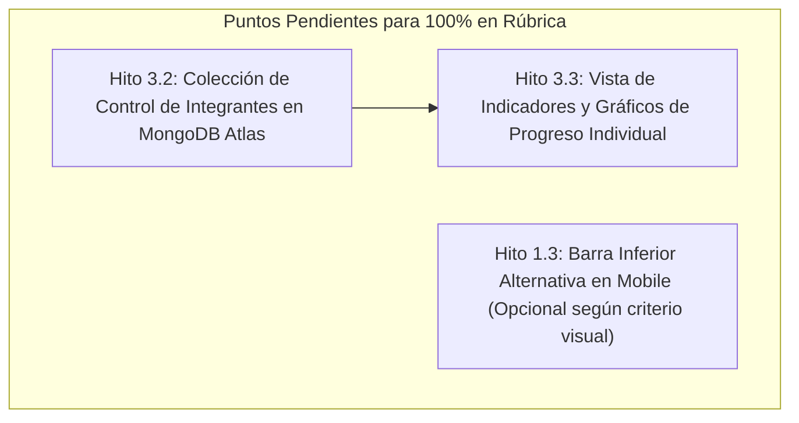

# Pendientes y Brechas para Cumplimiento Estricto del Avance 3 (Zenit)

**Proyecto:** Babilon — Biblioteca Virtual Eclesiástica & Archivo Literario  
**Equipo:** Zenit · **Integrantes:** Lopez Hu Jose Yael, Zapata Paredes Luiz Yael, Manzanilla Bass Emmanuel  
**Fecha de corte:** 19 de noviembre de 2026  

---

## 1. Resumen de Brechas Pendientes

Aunque el ecosistema Babilon cuenta con una arquitectura muy robusta y supera aspectos técnicos avanzados (como OCR con Gemini/MinerU, federación con Google Books y almacenamiento desacoplado de páginas), existen **dos puntos concretos del documento de avance** que requieren completarse para asegurar la calificación máxima (100 %) ante la rúbrica estricta del profesor:



---

## 2. Detalle de Tareas Pendientes por Hito

### HITO 3.2: Conexión con la colección de metadatos de control

* **Estado actual:**
  Actualmente existen las colecciones `libros`, `pages` y `usuarios`. Sin embargo, no existe una colección dedicada (ej. `control_equipo` o `metadatos_control`) que registre la labor de digitalización de cada uno de los 3 estudiantes.
* **Qué hace falta implementar:**
  1. **En MongoDB Atlas / Backend:**
     Crear la colección `control_equipo` con documentos como:
     ```json
     [
       {
         "integrante": "Lopez Hu Jose Yael",
         "libros_escaneados": 42,
         "meta_individual": 50,
         "ultima_actualizacion": "2026-11-19T06:00:00Z"
       },
       {
         "integrante": "Zapata Paredes Luiz Yael",
         "libros_escaneados": 48,
         "meta_individual": 50,
         "ultima_actualizacion": "2026-11-19T06:00:00Z"
       },
       {
         "integrante": "Manzanilla Bass Emmanuel",
         "libros_escaneados": 39,
         "meta_individual": 50,
         "ultima_actualizacion": "2026-11-19T06:00:00Z"
       }
     ]
     ```
  2. **Endpoint en Backend (`GET /api/admin/progreso`):**
     Endpoint protegido para administradores que calcule mediante agregación `$group` el total grupal frente a la meta global (ej. 129 de 150 libros).

---

### HITO 3.3: Renderizado de indicadores y gráficos de progreso

* **Estado actual:**
  El sistema cuenta con el panel de subida de libros (`/subir`), el gestor de páginas (`PageManager.tsx`) y el explorador de libros libres (`/explorar-libres`), pero no cuenta con una vista gráfica de métricas de equipo.
* **Qué hace falta implementar:**
  1. **Vista en Frontend (`/admin/metricas` o pestaña en `/subir`):**
     - Componente de barras de progreso porcentuales por integrante.
     - Indicador numérico central: `Total acumulado: X / Meta global: Y`.
     - Comparativa visual entre los integrantes del equipo.
     - Botón de refresco para demostrar en el aula que al cambiar un valor en Atlas Collections, el panel se actualiza de inmediato.

---

### HITO 1.3: Barra de navegación inferior móvil (Ajuste menor de presentación)

* **Estado actual:**
  Babilon implementa un navbar superior con desenfoque de cristal (`NavbarClient.tsx`) completamente adaptable y reactivo en SPA.
* **Qué hace falta (Opcional según rigidez del profesor):**
  - Si el profesor pide textualmente ver los botones en la parte inferior en móviles, habilitar un componente flotante `<BottomNav />` visible solo en pantallas `< md` (menos de 768px) con accesos rápidos: **Inicio**, **Biblioteca** y **Ajustes / Perfil**.

---

## 3. Plan de Acción Inmediato para el Equipo

1. **Paso 1 (Código Fuente):** Rotular e identificar todos los componentes clave con comentarios explícitos de diseño de interfaces y los códigos de cada Hito (Hito 1.1 a Hito 4.3) para que el evaluador identifique cada requerimiento en la inspección de código.
2. **Paso 2 (Colección de Control):** Crear el script o endpoint en el backend para poblar y servir los datos de `control_equipo`.
3. **Paso 3 (Componente Visual de Métricas):** Añadir la tarjeta o pestaña de métricas del equipo en la interfaz de administración para la demostración en aula.

